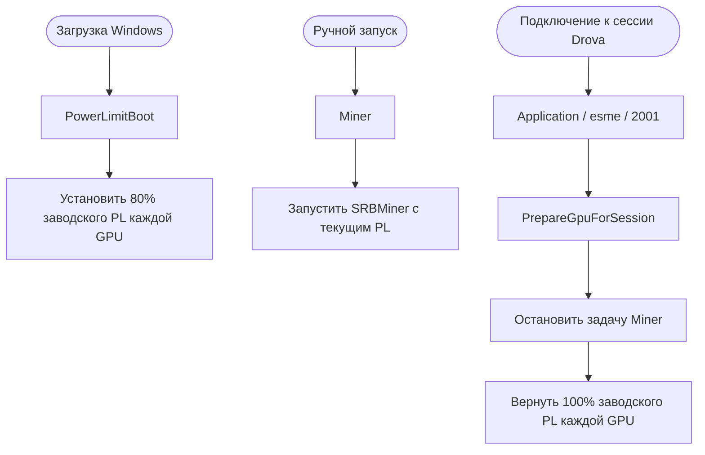

# Переписывание глобального ограничения 144FPS → 60FPS при начале сессии

0. Прочитать файлы `60fps.nip`, `60fps.xml` и `fps60limit.ps1` и убедиться, что вы понимаете каждую строчку.
1. Положить `60fps.nip` и `fps60limit.ps1` в папку `C:\ProgramData\Drova`, запустить один раз `fps60limit.ps1` в терминале.
    ```powershell
    powershell -ExecutionPolicy Bypass -File .\fps60limit.ps1
   ```
    
2. Импортировать `60fps.xml` в планировщике задач Windows

## Блокировка клиентов по `client_id`

`DrovaBlacklistGuard.ps1` проверяет первый элемент ответа
`https://services.drova.io/session-manager/sessions` при подключении игрока. Если
`sessions[0].client_id` присутствует в чёрном списке, скрипт показывает
полноэкранное сообщение `:(` и назначает принудительную перезагрузку через минуту.
Полный текст причины показывается системным уведомлением Windows о перезагрузке.

При любой ошибке чтения реестра, файла или API подключение не блокируется. Причина
записывается в `C:\ProgramData\Drova\ClientBlacklistGuard.log`. Токен и полный
ответ API в журнал не записываются.

### Чёрный список

Создайте файл `D:\bads.txt`. В каждой непустой строке должен находиться один UUID
клиента:

```text
7e941ec1-f733-85ff-82ac-240e7d3b311f
ae6cbf9c-2649-6eff-8a27-94fb2521bc7b
```

Пробелы по краям строк и регистр букв не учитываются. Некорректные непустые строки
игнорируются и отмечаются в журнале.

### Установка

Важно: войдите именно в ту Windows-учётную запись, под которой работает игрок, и
откройте PowerShell **от имени администратора**. Задача привязывается к текущей
учётной записи с типом входа `InteractiveToken`; при установке от `SYSTEM` окно не
сможет появиться в пользовательском сеансе.

Положите `DrovaBlacklistGuard.ps1` и `Install-DrovaBlacklistGuard.ps1` в одну
папку и выполните:

```powershell
powershell.exe -NoProfile -ExecutionPolicy Bypass -File .\Install-DrovaBlacklistGuard.ps1
```

Установщик:

- копирует guard в `C:\ProgramData\Drova\DrovaBlacklistGuard.ps1`;
- создаёт задачу `\Drova\ClientBlacklistGuard`;
- настраивает событие `Application / esme / 2006` (подключение в режиме рабочего стола);
- запрещает запуск второго экземпляра, пока работает первый.

Файл `D:\bads.txt` не создаётся и не изменяется установщиком. Если его нет, будет
показано предупреждение, а guard продолжит разрешать подключения.

### Проверка

1. Откройте планировщик задач и проверьте задачу
   `\Drova\ClientBlacklistGuard`.
2. На вкладке триггеров должно быть событие журнала `Application`, источник
   `esme`, код `2006`.
3. В свойствах задачи должен быть выбран текущий игровой пользователь и запуск
   только при его входе в систему с наивысшими правами.
4. Сначала проверьте UUID, которого нет в `D:\bads.txt`: в журнале должна появиться
   запись `is not blocked`, без окна и перезагрузки.
5. Проверку заблокированного UUID проводите только когда готовы к перезагрузке:
   guard сразу вызывает `shutdown.exe /r /f /t 60`.

Если тестовую перезагрузку нужно отменить из административной консоли до истечения
минуты, выполните:

```powershell
shutdown.exe /a
```

### Удаление

Из игровой учётной записи откройте PowerShell от имени администратора и выполните:

```powershell
powershell.exe -NoProfile -ExecutionPolicy Bypass -File .\Install-DrovaBlacklistGuard.ps1 -Uninstall
```

Задача и установленный guard будут удалены. Файл `D:\bads.txt` и журнал останутся
на месте.

## SRBMiner и лимиты питания NVIDIA

Скопируйте `Install-DrovaMining.ps1` и `Set-DrovaGpuProfile.ps1` в одну папку.
На каждом игровом ПК запустите установку из 64-разрядного Windows PowerShell от администратора.
Укажите фактический путь на смонтированном iSCSI-томе и свой Mining Username из профиля Kryptex.

```powershell
.\Install-DrovaMining.ps1 -MinerPath 'D:\Mining\SRBMiner-MULTI.exe' -KryptexLogin 'krxXXXXXX'
```

Установщик добавляет папку EXE (в примере `D:\Mining`) в исключения Microsoft Defender. Используйте отдельный каталог для майнера. Если Defender уже поместил EXE в карантин, сначала восстановите файл в журнале защиты Windows. При смене пути или запуске с `-Uninstall` установщик снимает созданное им исключение. Исключения, добавленные до установки, сохраняются.

### Какие аргументы получает SRBMiner

При логине `krxXXXXXX` и имени компьютера `fifth` задача `\Drova\Miner` запускает такую команду:

```powershell
& 'D:\Mining\SRBMiner-MULTI.exe' --disable-cpu --algorithm pearlhash --pool prl-ru.kryptex.network:8048 --wallet "krxXXXXXX.fifth" --tls true
```

| Аргумент | Назначение |
| --- | --- |
| `--disable-cpu` | Отключает майнинг на CPU. |
| `--algorithm pearlhash` | Выбирает алгоритм для Pearl (PRL). |
| `--pool prl-ru.kryptex.network:8048` | Подключает майнер к российскому серверу пула Kryptex. |
| `--wallet` | Установщик соединяет `-KryptexLogin` и `$env:COMPUTERNAME`. Для Mining Username получается `krxXXXXXX.fifth`, для email — `user@example.com/fifth`. |
| `--tls true` | Включает TLS для соединения с пулом. |

Чтобы посмотреть фактическую команду на конкретном ПК:

```powershell
(Get-ScheduledTask -TaskPath '\Drova\' -TaskName Miner).Actions | Format-List Execute,Arguments,WorkingDirectory
```

### Как работают задачи Планировщика Windows



Все три задачи находятся в `\Drova\`. Загрузочная задача учитывает минимальный PL каждой карты. Если драйвер ещё не готов, Планировщик повторяет попытку до трёх раз. После обработки подключения поздняя загрузочная попытка пропускает установку 80%.

Майнер работает от LocalService с рабочим каталогом в папке EXE. Этой учётной записи нужен доступ к майнеру на чтение и исполнение. После завершения сессии майнер остаётся остановленным до ручного запуска. Если запустить его снова до перезагрузки, сохранится игровой PL 100%.

Команды управления и проверки:

```powershell
schtasks /Run /TN "\Drova\Miner"
schtasks /End /TN "\Drova\Miner"
nvidia-smi --query-gpu=name,power.limit,power.default_limit --format=csv
Get-Content "$env:ProgramFiles\Drova\Mining\gpu.log" -Tail 20
```

Для проверки подключитесь к игровой сессии и убедитесь, что процесс SRBMiner завершён, а оба столбца PL совпадают для каждой карты. Чтобы удалить три задачи и локальный скрипт, выполните `.\Install-DrovaMining.ps1 -Uninstall`. Журнал и файлы майнера сохраняются.
